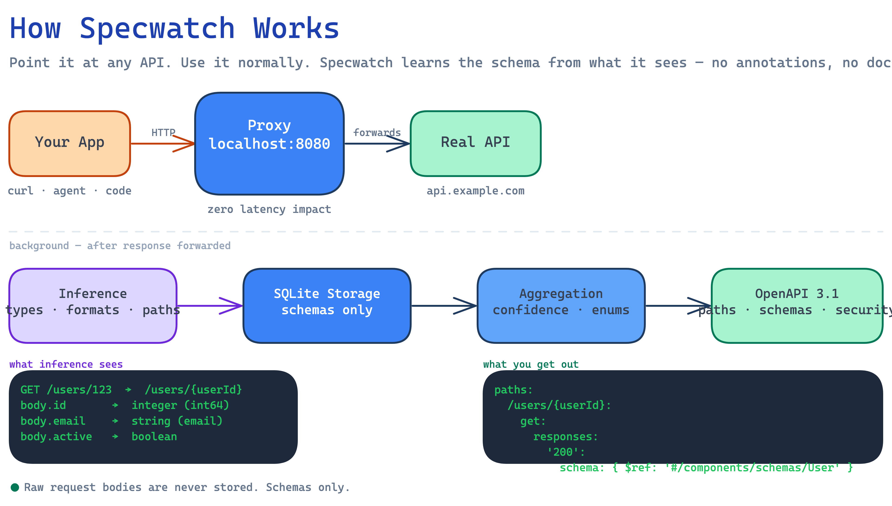
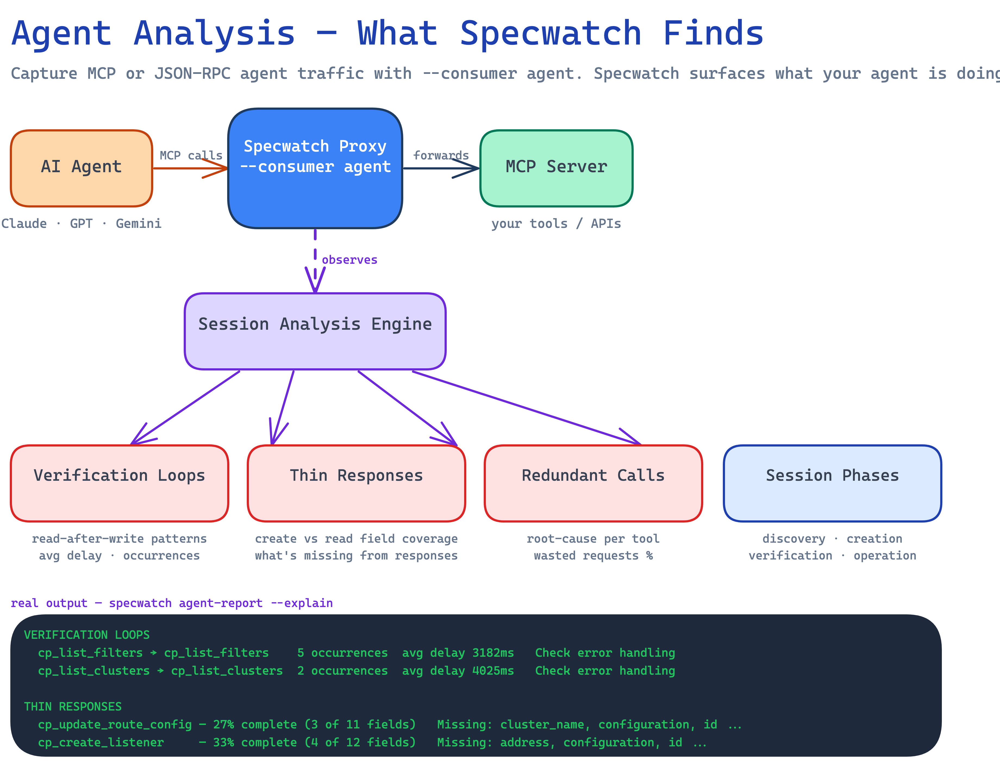

# Specwatch

[](https://github.com/rajeevramani/specwatch/actions/workflows/ci.yml)
[](https://www.npmjs.com/package/specwatch)
[](https://opensource.org/licenses/MIT)

Specwatch learns JSON API schemas from observed HTTP traffic and exports OpenAPI. It also analyses REST and MCP/JSON-RPC agent sessions for repeated calls, read-after-write verification patterns and incomplete responses.

It runs as a local reverse proxy with SQLite storage. Schema inference and ordinary exports are local; optional `--explain` sends a constructed investigation prompt to your configured LLM service.

## Unreleased candidate status

This branch documents the human-approved **local candidate `0.4.0`**, not a published release. npm `latest` remains `0.3.2`; neither `0.3.3` nor the historical local `0.3.4` label is an evidenced npm release. Version approval authorizes preparation and exact-package qualification only, not publication. A version string alone does not identify verified repaired bytes.

The header privacy correction, default JSON agent output, plain capture output and investigation JSON described below are candidate behavior. **Do not install `latest` or an old package while assuming it has these guarantees.** Use an explicitly approved repaired candidate, recording its tarball checksum and installed CLI checksum/version. The standalone source skill at `skills/learn-api/SKILL.md` is candidate-only and unlisted until a repaired published artifact is verified.

Commands below assume that exact installed candidate is available as `specwatch`. For source development, run `npm ci` and `npm run build`, then substitute `node dist/index.js` for `specwatch`. Installation may run native dependency build scripts; approve installation before running it. These are local preparation instructions, not a release or publication announcement.

## Where to use it

Use Specwatch in development or staging to bootstrap a spec for an undocumented API, inspect observed schema changes, or investigate agent request patterns. Do not put it in a production payment flow or another critical path.

Generated specs describe **observations, not the complete API contract**. Unexercised operations, rare errors, unseen optional fields and alternative branches remain unknown. Counts and confidence describe captured evidence, not a percentage of total API coverage. Review paths, nullability, required fields and component references before generating clients or treating a spec as authoritative. Traffic-derived OpenAPI exports conservatively omit sampled categorical enum constraints by default; opt in explicitly when those estimated closed sets are useful.

## Learn an API



Choose an approved target, unused local port, fresh session name and a new private store directory. The examples use POSIX shell syntax; adapt environment assignment to your shell.

```bash
export SPECWATCH_HOME="/absolute/path/to/new-private-capture-directory"
specwatch start https://api.example.com --port 8080 --name "my-api" --max-samples 200
```

Keep this process in its foreground terminal. From another terminal, rewrite your request base URL to the reverse proxy:

```bash
curl http://localhost:8080/users
curl http://localhost:8080/users/123
```

Specwatch is a reverse proxy: setting `HTTP_PROXY` is not a substitute for rewriting the URL. Start with approved read-only requests. Creating, updating or deleting data and intentionally provoking errors require separate target-specific permission. Supply credentials through an approved secret mechanism, not chat, shell history or request logs.

Stop the owned capture process with `Ctrl+C`; normal shutdown performs final aggregation. A sample limit without `--auto-aggregate` also stops capture. Then, using the **same** `SPECWATCH_HOME`:

```bash
specwatch sessions list
specwatch export --name "my-api" --include-metadata --output openapi.yaml
```

Choose a new output path; export can overwrite an existing file. If final aggregation did not complete, inspect the session state and, after the owned capture has stopped, explicitly run:

```bash
specwatch aggregate --name "my-api"
```

For long captures, add `--max-samples 200 --auto-aggregate`. It aggregates every 200 samples and continues until you stop the process; each aggregation creates a snapshot. `--auto-aggregate` requires `--max-samples`.

```bash
specwatch snapshots --name "my-api"
specwatch export --name "my-api" --snapshot 2 --include-metadata --output snapshot-2.yaml
```

Human sessions use plain, line-oriented output even on an interactive terminal. Stop the owned process with `Ctrl+C`; inspect snapshots and export through the explicit commands above. The previously developed dashboard is dormant and unsupported in `0.4.0`, with no CLI opt-in or dashboard hotkeys. It is not claimed fixed or qualified.

### What inference captures

- Observed paths/methods and inferred path parameters. Numeric, UUID and recognized digit-bearing values retain contextual normalization; uncertain alphabetic paths such as `/owners/owner_alice` remain literal. Matching response shapes alone do not justify combining static resources such as `/config/theme` and `/config/language`.
- JSON body types, nested objects/arrays, formats and union shapes. Shared models preserve their constraints and reference shared children; differently constrained shapes do not share an arbitrary representative.
- Required fields based on 100% presence within each observed object population, including non-null union variants and array elements; genuinely missing fields remain optional. PATCH request fields are not marked required.
- Low-cardinality string enum candidates, including alphabetic code-suffix fields, subject to sample and field/value heuristics. Candidates remain in stored learning data/raw JSON; OpenAPI enforces them only with `--include-inferred-enums`. Observed labels do not prove that the API has a closed value set.
- Query parameters, observed response codes and schema differences across sessions.
- Structural header names and derived Bearer/Basic classifications; X-API-Key presence supports API-key discovery.

Current request-body aggregation prefers successful (2xx) observations when any exist, excluding error-only request fields; when no 2xx exists, it uses the observed error groups. Repeated-call and completeness classifications are heuristics, not proof that a call was unnecessary or that a missing field caused it. Some OpenAPI/analysis correctness boundaries remain under revalidation; this candidate is not release-qualified merely because a fixture passes.

### Conservative contracts and optional enum constraints

By default, traffic-derived OpenAPI leaves learned categorical strings open while preserving observed types, formats, required fields and nullability. Repeatedly seeing one bank identifier or two status labels does not establish that other strings are invalid. To restore the earlier sampled-enum validation behavior, opt in per export:

```bash
specwatch export --name "my-api" --output conservative.yaml
specwatch export --name "my-api" --include-inferred-enums --output sampled-enums.yaml
specwatch export --name "my-api" --format json --output learning-data.json
```

`--include-inferred-enums` applies to OpenAPI 3.1/3.0 in either JSON or YAML, independently of `--include-metadata`. It has no effect on raw `--format json`, which retains candidate enum information unchanged. Opt-in constraints may reject unseen-but-valid values; review them before client generation or validation.

The conservative policy also applies immediately to previously stored snapshots, without reaggregation or database mutation. Existing exported files are not rewritten. Model discovery runs after the chosen policy, so component names/references can differ between modes. Regenerate and compare specs/client bindings when switching modes. Programmatic lower-level schema converters still preserve explicit caller-provided enum constraints. OpenAPI 3.0's `enum: [null]` null-only encoding remains intact: it is a semantic representation, not a guessed category.

Within the existing model-name priorities, competing eligible paths now use a fixed, locale-independent lexical tie-break instead of whichever usage arrived first. Some fallback component names change; inspect regenerated references. Structural names, successful/top-level preferences and promotion thresholds remain unchanged.

## Header privacy and database upgrades

In the repaired candidate, retained header metadata contains valid **lowercase names only**, plus an optional sorted closed `authSchemes` array (`bearer`, `basic`) for `authorization`. No raw, masked or empty header `example` field is retained. Unknown schemes retain the header's name, not arbitrary scheme text. Forwarded peer header values are unchanged.

Raw JSON and OpenAPI exports defensively project header inputs. Observed application headers remain optional string parameters on each operation, without examples, even when shared by all operations. `x-specwatch-global-headers`, when metadata is enabled, describes names present across operations—not equality of former header values. Authentication/transport headers are excluded from ordinary operation header parameters.

On open, migration **v4** logically removes legacy header values/examples from both request/response columns in samples and aggregated schemas. It preserves nonheader records and snapshots; malformed stored header JSON fails closed and rolls back the v4 step with a fixed value-free error. An older binary rejects a v4 database. This is forward-only: there is no downgrade that restores examples.

**Logical cleanup is not secure erasure.** Old values may remain in free pages, WAL files, filesystem snapshots, backups and existing exports. Those files are not automatically rewritten, deleted or vacuumed. The new-output guarantee does not apply retroactively to caller-owned files.

If an upgrade fails, do not print the broken header JSON, force the schema version, bypass migration or resume live capture with the old value-retaining binary. To continue fresh, choose a **different, empty `SPECWATCH_HOME`**, leaving the failed store untouched. Contact the maintainer privately if historical sessions must be recovered; do not upload the database to a public issue.

This header guarantee is not a universal secret scanner. Candidate enum strings retained in learning data/raw JSON or opt-in OpenAPI, query/path observations, target URLs and generated files can still be sensitive. Conservative OpenAPI is not a general-purpose sanitization pass. Raw JSON request/response bodies are buffered transiently for inference rather than stored as body transcripts. Use synthetic data where possible, keep stores/exports private and review artifacts before sharing.

## Agent analysis



```bash
specwatch start https://your-mcp-server.example --consumer agent --name "my-agent" --max-samples 200
```

Exercise approved traffic and stop the owned process before generating reports. Set `SPECWATCH_HOME` consistently for capture and report commands.

### Machine-readable evidence is the default

```bash
specwatch agent-report --name "my-agent" > evidence.json
specwatch agent-report --name "my-agent" --output evidence-copy.json
```

Default stdout is JSON with `schema_version: "specwatch.agent_evidence.v1"`. `--output` additionally writes the JSON evidence file; it does not switch stdout back to tables. Keep diagnostics on stderr separate from machine-readable stdout. Do not combine them with `2>&1` when parsing JSON.

For human-readable tables:

```bash
specwatch agent-report --name "my-agent" --human
specwatch agent-report --name "my-agent" --format human
```

`--pretty` is another human-output alias. The report surfaces verification loops, thin responses and redundancy signals; these are evidence to investigate, not proven causal explanations or guaranteed savings. Consecutive GET duplication compares concrete resource paths and captured query maps, not operation templates alone. Captured query maps retain the last value for a repeated key, so full repeated-query multiplicity is unavailable; matching captured inputs does not prove a request was unnecessary.

To attach source-spec navigation:

```bash
specwatch agent-report --name "my-agent" --spec openapi.yaml --output mapped-evidence.json
```

Operation-level evidence in schema v1 is REST-only. MCP/JSON-RPC sessions produce a run-level warning and no REST operation entries; use `--human` and `investigate` for their analysis. Mapping against a spec inferred from the same traffic is a navigation aid, not independent contract verification. Review ambiguous/unmatched mappings.

### Investigations

```bash
specwatch investigate --name "my-agent"
specwatch investigate --name "my-agent" --tool "cp_list_clusters"
specwatch investigate --name "my-agent" --json > investigation.json
```

`--json` emits the pinned snake_case `specwatch.investigation.v1` contract, including an `investigations` array. Without it, output remains human-readable.

### Optional LLM explanations

```bash
specwatch agent-report --name "my-agent" --human --explain
specwatch investigate --name "my-agent" --explain
```

`--explain` uses local Ollama or an OpenAI-compatible endpoint configured by `LLM_BASE_URL`, `LLM_API_KEY` and `LLM_MODEL`. Supply the API key privately; do not paste it into a shared command or transcript. The configured endpoint receives selected operation/timing/cause information, not header objects or body transcripts, but operation names can themselves be sensitive. Obtain permission before sending those prompts outside your environment. LLM explanations are interpretations, not deterministic findings; ordinary inference/export do not need an LLM.

## Command reference

```bash
specwatch start https://api.example.com --port 8080 --name "my-api" --max-samples 500 --auto-aggregate
specwatch status
specwatch sessions list
specwatch aggregate --name "my-api"
specwatch snapshots --name "my-api"
specwatch export --name "my-api" --include-metadata --output spec.yaml
specwatch export --name "my-api" --json
specwatch export --name "my-api" --format json
specwatch export --name "my-api" --openapi-version 3.0
specwatch export --name "my-api" --min-confidence 0.8
specwatch diff --name1 "v1" --name2 "v2"
```

`--json` with the default OpenAPI format selects JSON serialization of OpenAPI; `--format json` selects raw aggregated-schema JSON instead. Output defaults to stdout; `--output` writes a file. Use `--help` on the exact installed candidate for complete options.

Prefer `Ctrl+C` on the owned foreground capture. The `stop` command can mark the session stopped/aggregate, but is not a general process-ownership mechanism. `sessions delete <id>` deletes stored session data: use it only with explicit permission for that exact session.

## Runtime requirements and development

The candidate requires **Node.js >=22**, matching its Ink dependency requirements; CI targets Node22. Node20 is no longer a supported runtime for this candidate. Earlier Node20 execution of the historical package is not support or interactive-TUI qualification for `0.4.0`. Qualification is specific to the exact installed artifact, runtime and platform; do not override engine checks and call the result supported.

```bash
npm ci
npm run build
npm run test
npm run typecheck
npm run lint
```

Source tests require Python3 for the owned real-terminal regression (configured explicitly in CI); the installed CLI does not require Python. `npm run test` builds the CLI before Vitest so subprocess tests exercise the current bundle. `npm run format` rewrites source formatting; avoid running it across unrelated user edits. CI checks lint, typecheck, tests and build on its configured Node matrix; local success is not evidence that remote CI ran.

## License

MIT
